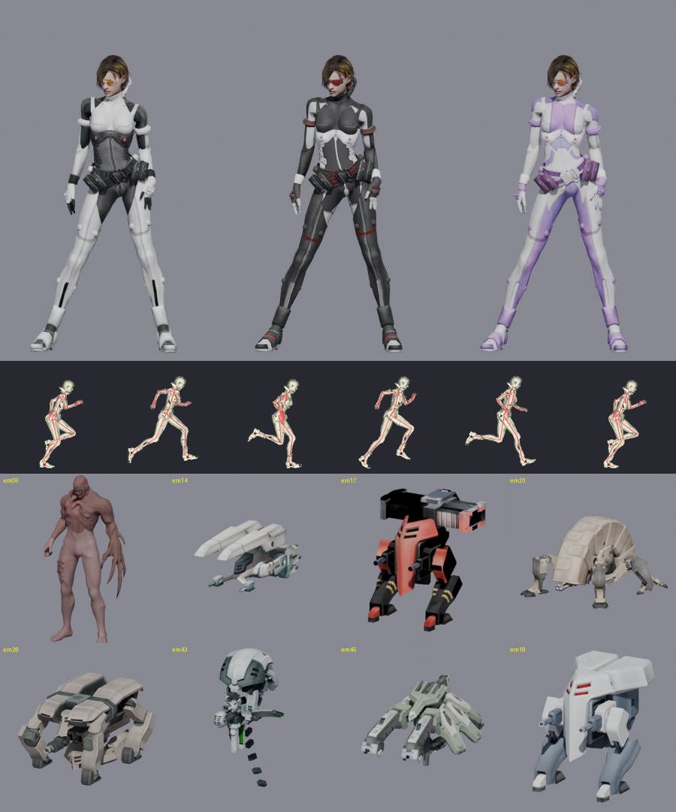
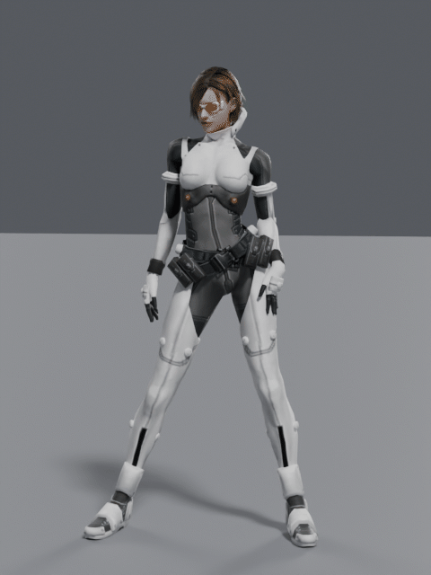
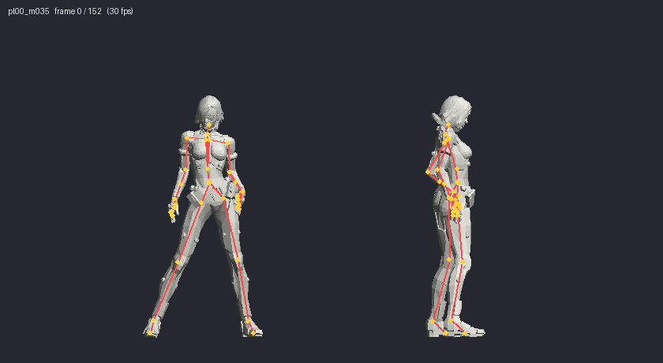
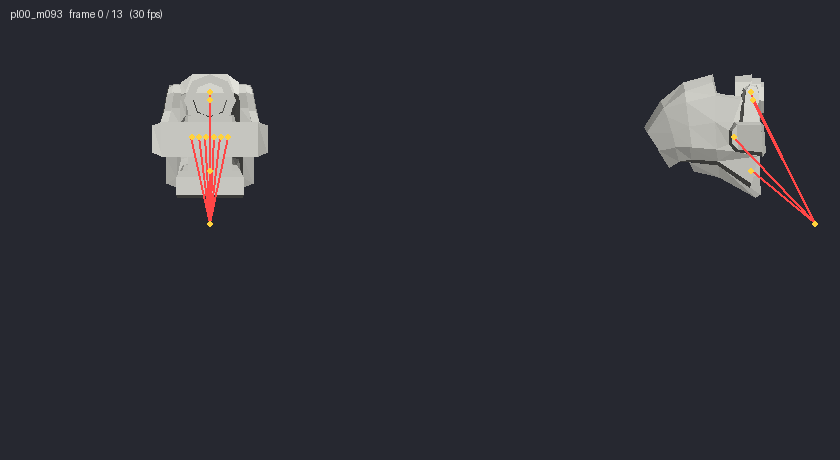
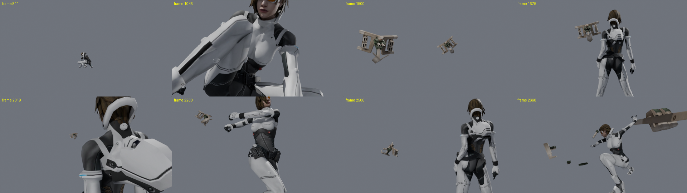

# P.N.03 Research

File formats, animation system and cutscene data of **P.N.03** (Capcom, GameCube, 2003). Includes a blender import script.

This repo does not contain game files. Piracy is illegal!

## What's in here

| Path | What it is |
| --- | --- |
| [`docs/formats.md`](docs/formats.md) | Byte-level specs for `.dat` archives, BIN models, TPL textures, FCV animations, the LZS compression, room files and cutscene events, and the `MEKA.sym` symbol map |
| [`docs/animation.md`](docs/animation.md) | Information about the animation files.|
| [`main`](main) | The Blender add-on (`io_import_pn03.zip`) and its source |

## The Blender add-on

Install `blender/io_import_pn03.zip` through Edit > Preferences > Add-ons > Install from Disk, then enable it. If you're replacing an older version, restart Blender afterwards. Works on 3.6-4.3.

Might work on 5.2+

**File > Import > P.N.03 Archive (.dat)** :

| File | Contents |
| --- | --- |
| `pl00.dat` | Vanessa (40-bone body), a small 10-bone gadget, 92 animations |
| `em09.dat` to `em50.dat` | Enemies and bosses |
| `ev00.dat` to `ev05.dat` | Cutscene versions of characters (ev00 is a 99-bone Vanessa with fingers and face) |
| `wep02.dat`, `wep03.dat` | Weapon parts built on Vanessa's skeleton |

You get skinned meshes, textures and every animation as an Action, with the game's leg IK baked in. Actions are named like `pl00_m006_Run` or `pl00_m035_Odori_5`. The Suit option loads the alternate costume textures `pl00N.tpl` and `pl000N.tpl` from the same folder. For weapons, import `pl00.dat` first, keep `pl00_0_rig` selected, then import `wep02.dat` with Attach to Active Armature on.

**File > Import > P.N.03 Cutscene (.lze)** takes a room file from `files/stX/`, for example `st0/r000.lze` for the intro. It loads every character in the event, bakes all cuts onto one timeline and builds the event camera. The intro comes out as 33 cuts, 2,747 frames (about 92 seconds) with 7 characters.

Rooms with events: r000, r103, r113, r20a, r306, r312, r405, r509, r60c, r70b, r80c, r80d, r80e, r90e, ra10, ra11, ra12, ra13, rb04.

Defaults are 30 fps, metres (game units are millimetres) and Z-up (the game is Y-up).

| Idle (m005, Cycles) | Pirouette (m035, skeleton) | Gadget unfold (m093) |
| --- | --- | --- |
|  |  |  |

## Credits

Research and tooling by ArcherOfLegend. P.N.03 is © Capcom. This project isn't affiliated with Capcom or Nintendo.
