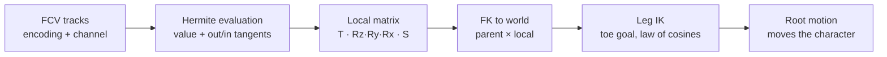

# P.N.03 animations

Each frame the game evaluates the FCV curves, builds each bone's local matrix and chains them into world space with FKs. Then the leg IK overwrites the legs.



## Local matrices

`RotMatrix` builds Rz · Ry · Rx from three angles similar to XYZ Euler. `ModelMatCalc` writes that rotation, sets the translation column, then post-multiplies scale, so the local matrix is T · R · S.

A bone with no translation track stays in the bind pose offset. Scale tracks are rare on characters but used heavily by the gadget (its six parts stretch up to 5× when it unfolds).

`MotionMoveCore` routes each track by the low byte of its descriptor:

| Flag | Goes to |
| --- | --- |
| 0x02 | Rotation |
| 0x10, 0x20 | Rotation, IK thigh |
| 0x04 | Translation (on an IK foot this is the IK goal) |
| 0x08 | Scale |
| 0x01 | Root Bone Movement |

Mirrored playback (flag 0x40 on the motion, not the track) negates X translation and the Y and Z rotations through a left/right bone table.

## Leg IK

Reversed from `IKInit`, `InverseKinematics`, `ikCalc` and `heel_toe`.

A track with flag 0x10 or 0x20 marks a thigh, bone N. Following the parts list order, N+1 is the knee, N+2 the foot and N+3 the toe. On initialization, `IKInit` builds an orientation frame from the rest leg direction (thigh to foot) and the pole axis in descriptor bits 8 to 11, with Z along the leg and X = normalize(pole × leg). That X is the bend axis. Vanessa's legs use pole +Z (forward).

Each frame:

1. The translation track on the foot is a goal in **character space**. The game multiplies it by the character matrix, so it moves with root motion.
2. The toe is also a goal. `heel_toe` sets the foot's rotation from its own track, also in character space, and backs the ankle position off by the toe's rest offset rotated by that.
3. `ikCalc` takes the distance d from the thigh to the ankle target and the rest bone lengths L1 and L2 (436 and 440 mm on Vanessa). With the cosines clamped to ±1:

   ```
   θ1 = acos((L1² + d² - L2²) / (2·L1·d))      thigh
   θ2 = acos((d² + L2² - L1²) / (2·d·L2))      knee
   ```

   Out of reach, both are 0 and the leg goes straight.
4. The bend axis is the thigh's **FK** rotation applied to X. So the thigh's own rotation track only controls the knee's swivel. A frame F is built with Z toward the target and X along that axis, and both bones start from F · Oᵀ.
5. The thigh is rotated by -θ1 and the knee by +θ2 about X. The knee's position is rebuilt from the thigh, the ankle is snapped to the end of the knee, and the toe goes back through normal FK.

## Root motion

The 0x01 track on bone 0 is the character's own displacement (the `cEm` object). `MotionGetSpeed` differentiates it each frame to move the character.

## Frame rate

All animations are in 30 FPS.

## Cutscene motion

See [formats.md](formats.md#evt-cutscene-event).
