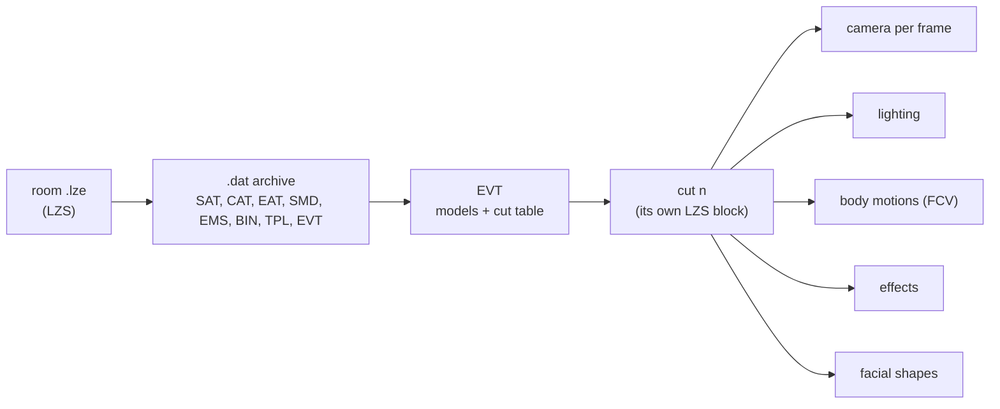

# P.N.03 file formats

All data is big-endian.

## Disc layout

| Path | Contents |
| --- | --- |
| `sys/main.dol` | The executable |
| `files/MEKA.sym` | Full symbol map for `main.dol` (see the end of this page) |
| `files/em/*.dat` | Characters: `pl00` Vanessa, `em*` enemies, `ev*` cutscene characters, `wep*` weapons |
| `files/em/pl00N.tpl`, `pl000N.tpl` | Alternate suit textures for Vanessa's body and gadget |
| `files/st0` to `files/stb/*.lze` | Rooms, also contain cutscene events |
| `files/se`, `files/Bgm` | Sound and music |
| `files/movie/*.thp` | FMV |
| `files/debug/` | Leftover debug camera dumps and a `config.txt` |

## .dat archive

```
u32  count
u32  offset[count]      absolute
char type[count][4]     "BIN", "TPL", "EFF", "FCV"
```

## BIN model

Same family as Resident Evil 4's GameCube BIN (both are Capcom Production Studio 4).

### Header (0x40 bytes)

| Offset | Type | Meaning |
| --- | --- | --- |
| 0x00 | u32 | Bone table offset (always 0x40) |
| 0x0C | u32 | Vertex colour offset |
| 0x10 | u32 | UV offset |
| 0x14 | u32 | Weight table offset |
| 0x18 | u8 | Weight entry count |
| 0x19 | u8 | Bone count |
| 0x1B | u8 | Draw group count |
| 0x1C | u32 | Draw groups offset |
| 0x20 | u32 | Bit 31 set: display-list vertices carry a colour index |
| 0x24 | u32 | Texture count |
| 0x28 | u8 | Position shift n, position = s16 / 2^n (4 on Vanessa, 0 on the gadget, 5 on some enemies) |
| 0x30 | u32 | Positions offset |
| 0x34 | u32 | Normals offset |
| 0x38 | u16 | Position count |
| 0x3A | u16 | Normal count |

### Sections

| Section | Record | Notes |
| --- | --- | --- |
| Bones | `u8 id, u8 parentId, u8 pad[2], f32 x, y, z` | Parent 0xFF is the root. |
| Positions | `s16 x, y, z, u16 weightIndex` | Model (bind) space |
| Normals | `s16 x, y, z, s16 pad` | Divide by 16384 |
| UVs | `u16 u, v` | Divide by 256. V is top-down |
| Colours | `u8 rgba[4]` | Mostly 01 01 01 01 on characters |
| Weights | `u8 boneId[3], u8 count, u8 percent[3], u8 pad` | Percentages are rounded and can total 98 or even 200, so normalize |

Weights reference bone **ids**. Weapon BINs use sparse ids that match Vanessa's skeleton (8, 9, 13, 14, 24, 25) with the same world rest positions because they're skinned to her arms.

### Draw groups

Each group is a 0x20-byte header followed by a raw GX display list.

| Header offset | Meaning |
| --- | --- |
| 0x0B | Material kind |
| 0x0C | u8 texture index[4], 0xFF = none |
| 0x10 | Colour |
| 0x18 | u32 display-list size |
| 0x1C | u32, close to the triangle count but not exact |

The display list is a run of primitives, ending at a 0 byte or the size:

```
u8  opcode    0x80 quads, 0x90 triangles, 0x98 strip, 0xA0 fan (low 3 bits = vertex format slot)
u16 count
vertex[count] = u16 pos, u16 normal, [u16 colour if header 0x20 bit 31], u16 uv
```

A bunch of tris are messed up due to internal winding caused by the game. This is resolved in the importer.

| Kind | Texture slots | Meaning |
| --- | --- | --- |
| 0 | colour | Plain |
| 1, 3 | colour, IA8 map | Spec map |
| 2 | colour, -, -, small number | ~ |
| 5 | colour, IA8, I4 alpha mask | Hair cards |

## TPL textures

Nintendo Texture Format, consult any other Nintendo Texture format guide..

## FCV animation

### Warning! Complicated mathematics!

Hermite function curves.

```
u16  frameCount
u8   trackCount
u16  desc[trackCount]          starts at offset 3, unaligned
u8   bone[trackCount]          bone id per track
     pad to 4
u32  extra                     points at trailing data, not needed for playback
u32  trackOffset[trackCount]   absolute, 0 = no data

track = axis x, axis y, axis z (back to back, no padding between axes)
axis  = u16 keyCount, u16 frame[keyCount], key[keyCount]
key   = value, tangentIn, tangentOut     (sizes set by the encoding)
```

### Descriptor

| Bits | Meaning |
| --- | --- |
| 12 to 15 | Encoding = 4 × valueFormat + tangentFormat. Format 0 = f32, 1 = s16, 2 = s8. Encodings 3, 7, 11 are unused |
| 8 to 11 | IK pole axis: 0 +Y, 1 -Y, 2 +X, 3 -X, 4 +Z, 5 -Z |
| 0 to 7 | Channel: 0x01 root motion, 0x02 rotation, 0x04 translation, 0x08 scale, 0x10 IK thigh, 0x20 IK thigh with heel/toe, 0x40 unknown (ignored by `MotionMoveCore`) |

Bytes per key by encoding (`Fcc_next_axis_addr`): 12, 8, 6, -, 10, 6, 4, -, 9, 5, 3. The nine decoders `Fcc_get_data_000` to `_022` sit in a jump table indexed by the encoding. Every integer value and tangent is multiplied by 0.0001. Rotation is in radians.

### Evaluation

`HermiteInterpolation` finds the segment around the current frame and evaluates the standard cubic Hermite with key A's out-tangent and key B's in-tangent. Tangents are already in segment units (there's no scaling by the frame gap):

```
h(s) = (1 - 3s² + 2s³)·p0 + (3s² - 2s³)·p1 + (s³ - 2s² + s)·m0 + (s³ - s²)·m1
```

Before the first key it holds the first value. Past the last key it holds the final value, or wraps when the loop flag is set. How the channels combine into a pose, including the leg IK, is in [animation.md](animation.md).

## LZS compression (.lze)

`LzsDecode` at 0x80077680. An LZ77 variant with separate flag and byte streams.

```
u32 outputSize
u32 flagStreamLength
u32 unknown
u8  flags[flagStreamLength]     read MSB first, starting at 0xC
u8  bytes[...]                  starts right after the flags
```

| Flags | Meaning |
| --- | --- |
| `1` | Literal: copy one byte |
| `01` | Long match: read a little-endian u16. Low 3 bits = length - 2, high 13 bits = distance. If the length bits are 0, read one more byte and length = byte + 9, and a distance of 0 then means end of stream |
| `00` | Short match: 2 more flag bits = length - 2, then one byte = distance |

Matches copy from `output.length - distance` and may overlap.

## Room files

A decoded `.lze` is an ordinary `.dat` archive. Entry types seen: collision (SAT, CAT, EAT), lights, the stage model (SMD/SMX), enemy spawns (EMS), BIN/TPL/FCV for room-local props, and one or more **EVT** cutscene events. The room scripts (`R000Main`, `Ra10Main` and so on) start an event with `cEvent::Initialize(roomData + offset[k])`.

## EVT cutscene event

```
u32 eventNo
u32 modelsOffset
u32 cutsOffset

models: u32 count, then count relative offsets to model records.
        Each record reaches its 4-character name through two more relative hops.
        Names are looked up in a 30-entry table and created with PullEm,
        so "ev00" loads files/em/ev00.dat.

cuts:   u32 count, then count × { u32 relativeOffset (from this entry) to an LZS block,
                                   u32 frameCount, u32 decodedSize }
```

### Cut block

Each cut is its own LZS block, decompressed by `evtCutArray::cutChange` when the cut starts. Decoded, it opens with five u32 section offsets:

| Section | Contents |
| --- | --- |
| 0 | Camera (`evtCamera::Update`): u32 count, then one 32-byte record per frame of 8 floats: eye XYZ, target XYZ (multiply by 100 for mm), roll in degrees, vertical FOV in degrees |
| 1 | Lighting set |
| 2 | Body motions |
| 3 | Effects |
| 4 | Facial shapes |



## MEKA.sym symbol map

```
u32 recordsOffset          0x15E4 on the US disc
u32 objectNamesOffset      0x1D49C, null-terminated .obj names
u32 symbolNamesOffset      0x20ECD, null-terminated demangled names
u32 0
u32 objectNameOffset[...]  from 0x10 up to the records

record (12 bytes): u32 address, u16 objectIndex, u16 flags, u32 nameOffset (from symbolNamesOffset)
```

9,530 records, C++ names and argument types, like `MotionSetCore(cEm *, _MOTION_INFO *, void *, void *, unsigned char, unsigned short, unsigned short)`. Basically a .pdb.